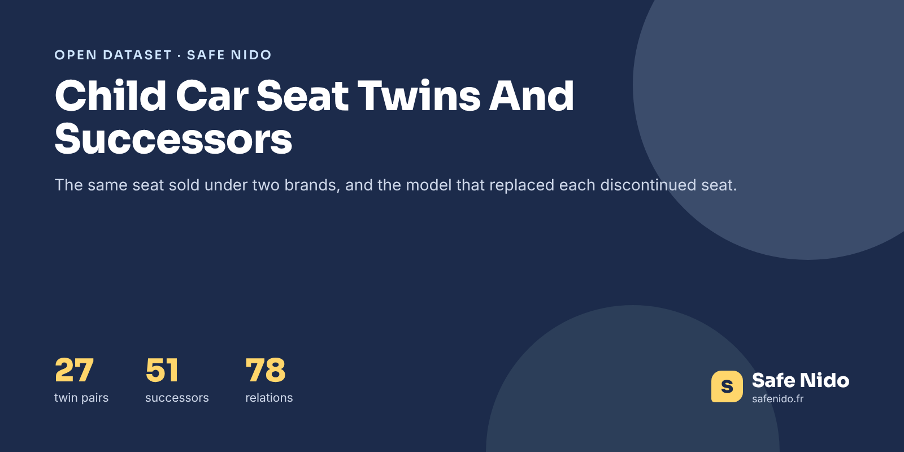

# Child Car Seat Twins And Successors



[](https://doi.org/10.5281/zenodo.24167315) [](https://www.kaggle.com/datasets/safenido/child-car-seat-twins-and-successors) [](https://huggingface.co/datasets/safenido/child-car-seat-twins-and-successors) [](https://creativecommons.org/licenses/by/4.0/) [](https://www.safenido.fr/)

**English first, version française plus bas.**

Two questions come up all the time in car seat shopping. Is this Bébé Confort the same seat as that Maxi-Cosi? And my seat is no longer sold, what replaced it? This dataset answers both, with **27 pairs of identical seats sold under two names and 51 discontinued seats with their successor**, each with its source and a link to both seats on Safe Nido.

### The Headline Numbers

|  |  |
|---|---|
| Relations | 78 |
| Same seat under two names | 27 |
| Discontinued seats with a successor | 51 |
| Relations where both seats are in Safe Nido | 49 |

Twins matter because a crash test of one applies to the other, which saves parents from thinking a seat was never tested. Successors matter because the old model's grade says little about the new one, it has to be tested again.

### Files

| file | content |
|---|---|
| `data/child_car_seat_twins_and_successors.csv` | 78 rows, one per relation |
| `images/cover.png` | Cover image, 1600 × 800 |

### Columns

**child_car_seat_twins_and_successors.csv**

| column | description |
|---|---|
| `relation` | same_seat_other_name or replaced_by |
| `seat_id` | Safe Nido identifier of the seat |
| `brand, model` | Brand and model of the seat |
| `other_name` | Name of the twin or of the successor |
| `other_seat_id` | Safe Nido identifier of the other seat, when it is in the base |
| `detail_en` | What the relation means |
| `source` | Where the relation was read |
| `read_on` | Date the source was read, for successors |
| `safenido_url, other_safenido_url` | Seat pages on Safe Nido |

### Load It

```python
import pandas as pd

base = "https://raw.githubusercontent.com/safenido/child-car-seat-twins-and-successors/main"
df = pd.read_csv(f"{base}/data/child_car_seat_twins_and_successors.csv")
df[df.relation == "same_seat_other_name"][["brand", "model", "other_name"]]
```

### How It Was Built

Twins come from the ADAC test notices, which state when a tested seat is identical to another one ("baugleich"). Successors were read on brand support pages, FAQs and manuals in October 2026. Names were cleaned and linked to the Safe Nido base when possible.

### Checked Against The Source

Every successor has its source text and reading date. Twin pairs are taken as ADAC states them.

### Read With Care

- **Not exhaustive.** Only relations stated by ADAC or by the brand are listed.
- **Twins can differ in fabrics or colours**, which can change the harmful substances result.

### License And Citation

**[CC BY 4.0](https://creativecommons.org/licenses/by/4.0/)**. Use it, share it and adapt it, commercially or not, and credit **Safe Nido** with a link to **[safenido.fr](https://www.safenido.fr/)**, along with the original source below.

```bibtex
@misc{safenido_child_car_seat_twins_and_successors_2026,
  title  = {Child Car Seat Twins And Successors},
  author = {{Safe Nido}},
  year   = {2026},
  doi    = {10.5281/zenodo.24167315},
  url    = {https://github.com/safenido/child-car-seat-twins-and-successors},
  note   = {Dataset, version 1.0}
}
```

Source. ADAC test notices, brand support pages and manuals, compiled by Safe Nido, https://www.safenido.fr/sieges-auto/

Archived on **[Zenodo](https://doi.org/10.5281/zenodo.24167315)** with a permanent DOI, 10.5281/zenodo.24167315.

Companion datasets, **[Child Car Seat Specifications Europe](https://github.com/safenido/child-car-seat-specs)** ([Kaggle](https://www.kaggle.com/datasets/safenido/child-car-seat-specifications-europe), [Hugging Face](https://huggingface.co/datasets/safenido/child-car-seat-specs)), **[Child Car Seat Recalls Europe 2016-2026](https://github.com/safenido/child-car-seat-recalls-europe)** ([Kaggle](https://www.kaggle.com/datasets/safenido/child-car-seat-recalls-europe-2016-2026), [Hugging Face](https://huggingface.co/datasets/safenido/child-car-seat-recalls-europe)). All Safe Nido datasets are listed in **[Child Passenger Safety Datasets](https://github.com/safenido/child-passenger-safety-datasets)**.

Also on **[GitHub](https://github.com/safenido/child-car-seat-twins-and-successors)**, **[Kaggle](https://www.kaggle.com/datasets/safenido/child-car-seat-twins-and-successors)** with a starter notebook, and **[Hugging Face](https://huggingface.co/datasets/safenido/child-car-seat-twins-and-successors)**, ready for the `datasets` library.

### On Safe Nido

The data behind these files is used on [Safe Nido](https://www.safenido.fr/), an independent French guide to child car seats built on twenty years of crash tests.

- [All car seats](https://www.safenido.fr/sieges-auto/)
- [Brands](https://www.safenido.fr/marques/)
- [Compare seats](https://www.safenido.fr/comparer/)

---

## Version Française

### Les Sièges Jumeaux Et Leurs Successeurs

27 paires de sièges identiques vendus sous deux noms (Bébé Confort et Maxi-Cosi le plus souvent) et 51 sièges arrêtés avec le modèle qui les remplace, chacun avec sa source et un lien vers les deux fiches sur Safe Nido.

Licence CC BY 4.0, en citant **Safe Nido** et un lien vers **[safenido.fr](https://www.safenido.fr/)**. Retrouvez les guides et les fiches des sièges sur [Safe Nido](https://www.safenido.fr/).
